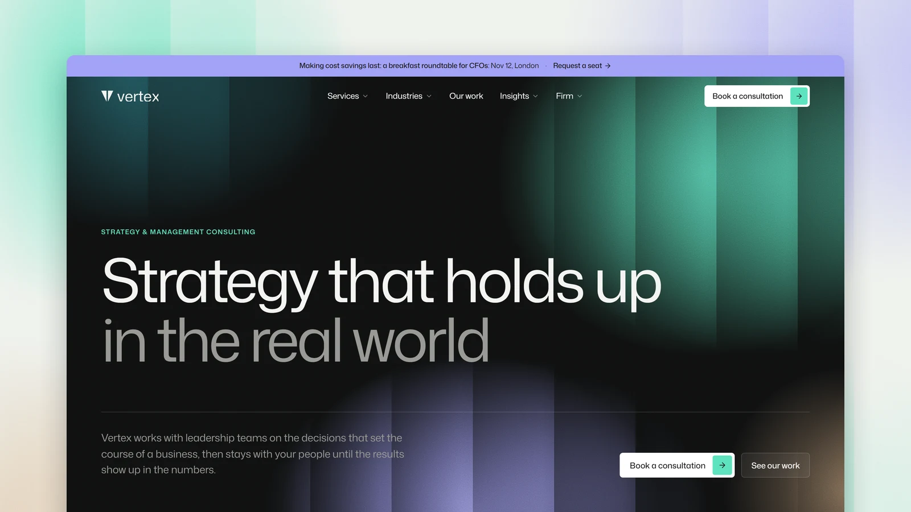

# Vertex - Astro Consulting Theme

[](https://vertex.xocoweb.workers.dev/)

[](https://astro.build/)
[](https://tailwindcss.com/)
[](https://www.typescriptlang.org/)
[](./LICENSE)

**Live preview:** https://vertex.xocoweb.workers.dev/

Vertex is a premium Astro theme for strategy, management and advisory firms. It pairs charcoal panels of soft colour behind ribbed glass, clean white sections, two-tone headlines in Mona Sans and a single mint accent, and it goes deeper than most consulting templates: services, industries, case studies, insights, partner profiles and a consultation booking flow, all linked to each other.

## Features

- A full-height, type-led hero over the ribbed-glass background, with no photo to replace
- Megamenus in one panel whose menus slide past each other, with a photo and headline figure for each service and industry
- Case study slices that open out under a heading whose highlighted sector rotates with them
- Service pages with outcomes, the questions clients bring, offerings, case studies, experts, insights and a FAQ
- Industry pages with figures, the shifts in the sector, services, a client quote, case studies and experts
- Case studies with headline results, an anonymous client, services, duration, the team and a pull quote
- A case study index filtered by industry and service
- Insights for articles, reports and events, with type archives, pagination, search and RSS
- Report pages with key findings and a PDF download, and event pages with a date card and registration
- Partner profiles with a bio, services, industries, the engagements they led and their writing
- A people page grouped by seniority and filtered by office
- A four-step consultation booking flow with a day and time picker and a live summary that introduces the partner for the chosen sector
- An announcement bar that promotes the next upcoming event
- About, careers with open roles filtered by team, contact with offices and their local time, privacy, terms and a 404 page
- A header that is clear at the top of the page, light once scrolled, and hidden while scrolling down, and a single SVG file for the logo
- Canonical URLs, sitemap, RSS, Open Graph, Twitter/X cards, and JSON-LD for services, case studies, articles, reports, events, people and FAQs
- Static output with no framework islands; every animation settles under `prefers-reduced-motion`
- Skip link, landmarks, labelled controls, visible focus states, and keyboard support for every menu, filter, form step and dialog

## Tech Stack

- Astro 7 with MDX
- Tailwind CSS 4 via the Vite plugin
- Vite 8, TypeScript, Astro content collections with references
- `@astrojs/sitemap`, `@astrojs/rss`, Sharp
- Self-hosted Mona Sans, Lucide and Bootstrap Icons, each with its license notice

## Requirements

- Node.js `22.12.0` or newer
- npm

## Getting Started

```bash
npm install
npm run dev
```

Build for production:

```bash
npm run build
```

Preview the production build locally:

```bash
npm run preview
```

Before shipping a change, run type checking, the production build, and the formatter check together:

```bash
npm run release:check
```

## Customization

See [CUSTOMIZATION.md](./CUSTOMIZATION.md) for site settings, the logo, navigation and megamenus, the services, industries, work, insights and people collections, offices, careers, the consultation, contact and newsletter forms, the homepage and about page, search, feeds, and the theme's design tokens.

Set `siteConfig.siteUrl` in [src/config/site.ts](./src/config/site.ts) before building — canonical URLs, share images, the sitemap, and the feed are all derived from it. The build is static, so any host that serves a directory works: `wrangler.jsonc` is included for Cloudflare Workers, and Netlify, Vercel, GitHub Pages, and object storage behind a CDN need no configuration beyond `npm run build`.

## Content

Services live in [src/content/services](./src/content/services), industries in [src/content/industries](./src/content/industries), case studies in [src/content/work](./src/content/work), insights in [src/content/insights](./src/content/insights) and people in [src/content/people](./src/content/people). Each entry is a folder with an `index.md` and the images it uses, validated by the schemas in [src/content.config.ts](./src/content.config.ts). Offices, open roles and page copy are in [src/config](./src/config).

The bundled demo content is fictional — the firm, its people, clients, engagements, events, reports and every figure are invented, so **replace them before launch.** The portraits are stock placeholders of people with no connection to the names beside them, and the report PDFs in `public/reports` are one-page placeholders.

Photographs come from [Unsplash](https://unsplash.com/) under the Unsplash license and [Pexels](https://www.pexels.com/) under the Pexels license. Insight covers are credited under the image on each entry. The other photographs are by Edmond Dantès (about), Mikhail Nilov (careers), Gustavo Fring, Petr, Anastassia Anufrieva, airfocus, Mario Gogh and Tiger Lily (services), Matthew Henry, Julia Koblitz, Nicholas Doherty, Zhenyu Luo, Anton Borzenkov and Tony Marinescu (industries), Etienne Martin, Hush Naidoo Jade Photography, the American Public Power Association, mos design, Franki Chamaki and Annie Spratt (case studies), Patrick Tomasso, Francesco Albertazzi, Henrique Ferreira and Swapnil Bapat (offices), and Vitaly Gariev, Gift Habeshaw, Juan Encalada and Christina @ wocintechchat.com (portraits).

## Support

See [SUPPORT.md](./SUPPORT.md) for what a license includes, and [CHANGELOG.md](./CHANGELOG.md) for release history.

## License

Commercial license. See [LICENSE](./LICENSE) for complete terms.

## Credits

- [Mona Sans](https://github.com/github/mona-sans) by GitHub, under the SIL Open Font License
- The Vertex wordmark is set in Mona Sans, converted to outlines
- [Lucide](https://lucide.dev/), under the ISC License
- [Bootstrap Icons](https://icons.getbootstrap.com/), under the MIT License
- Photography from Unsplash and Pexels
